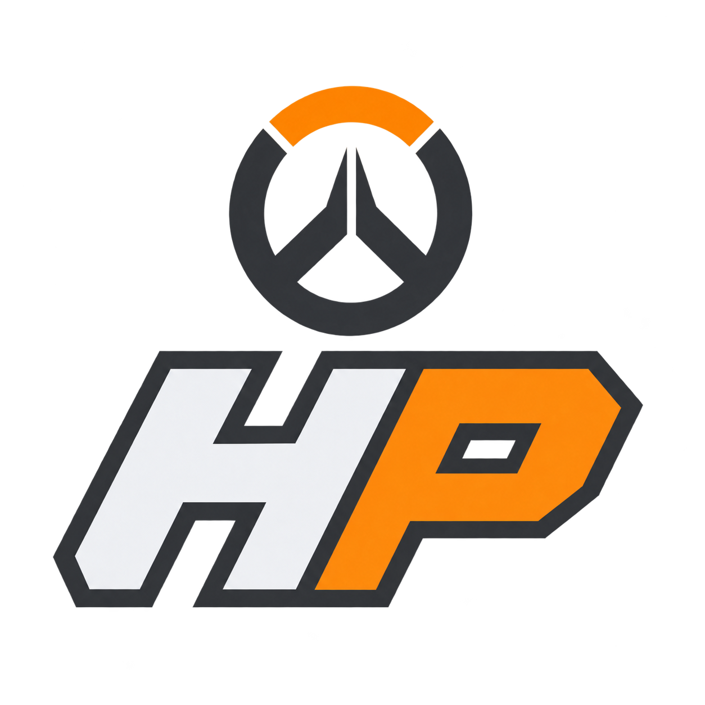
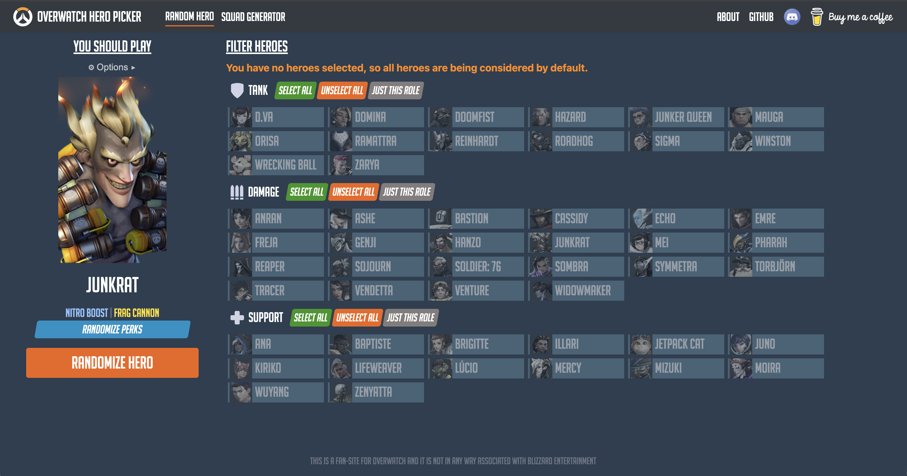

Repository for the Random Hero Picker for Overwatch.
This website allows Overwatch players to get a random suggestion of which hero to play based on a selection of heroes made by the player.

- **Website:** https://owheropicker.com



## Bugs and feature requests

If you find any bug or have a feature request, please post it on the [issue section](https://github.com/andrerfcsantos/overwatch-hero-picker/issues) of this repository.

## Feedback

Any feedback that is not a bug report or a feature request, please send to owheropicker@gmail.com. You can also join the [discord server](https://discord.gg/rwQMrCa).

## Tech Stack

- [Next.js](https://nextjs.org/) (App Router)
- [React](https://react.dev/)
- [TypeScript](https://www.typescriptlang.org/)
- [Tailwind CSS](https://tailwindcss.com/)
- [Oxlint + Oxfmt](https://oxc.rs/), through [Vite+](https://viteplus.dev) (`npm run lint`, `npm run format`)

## Building the site from source

Use these instructions to build the site from the source code and having it run on your own machine or server.

### Prerequisites

- [Node.js](https://nodejs.org/en/) 24 (the active LTS line)

The required major is declared in `package.json` in two places: `engines.node`,
which makes `npm install` fail on the wrong major (`engine-strict=true` is set in
`.npmrc`), and `devEngines.runtime`, which [Vite+](https://viteplus.dev) uses to
download and select the right runtime automatically. `@types/node` is kept on the
same major so the types match what actually runs.

### Running the site

- Clone the repo
- `cd` into the repo folder
- `npm install` to install the dependencies
- You can now run the site using `npm` directly or generate static files:
  - `npm run dev` to serve the site on localhost in development mode
  - `npm run build` to generate a production build
  - `npm run start` to serve the production build on localhost

## The two designs

The site ships a classic design and a new one ("refresh") side by side while
the new one is adopted. Visitors switch between them from the navbar, and the
choice is remembered in their browser.

- **Default:** `NEXT_PUBLIC_DEFAULT_DESIGN` sets what a visitor sees before
  they choose (`classic` unless set to `refresh`). See `.env.example`.
- **Code:** each page with two designs has one hook holding its behaviour
  (`src/hooks/usePicker.ts`, `src/hooks/useSquad.ts`) and two views over it.
  The new views live in `src/components/refresh`, their tokens in
  `src/app/refresh.css`.
- **Stream overlay:** OBS cannot read the streamer's choice, so the overlay
  link carries it as `look=refresh`. Links without it keep the classic card.
- **Adoption:** every PostHog event carries `design` and `design_origin`
  (`default`, `chosen`, or `link` on the overlay), and `design_switched`
  records each switch with the control it came from.

## Logos

The master artwork lives in [`images/logo/`](images/logo). Every size the site
uses (navbar logo, favicons, app and home-screen icons, the logo on the social
cards) is rendered from it and committed:

```bash
npm run generate-logos
```

Re-run it only when a master logo changes, and look at the results, especially
the 16px favicon.

## Stream overlay companion (rooms Worker)

The site itself is a static export served by Cloudflare Workers static assets.
The stream overlay's **companion view** (see each new hero on a phone or a
second screen) needs one live piece: a small Worker with a Durable Object in
[`workers/rooms`](workers/rooms), served at `wss://rooms.owheropicker.com`.

- The overlay link carries a random **publish secret** (`room=`); the overlay
  posts each roll to the room with it.
- The companion link carries the room's **view id** (`view=`), the SHA-256 of
  the secret. It can watch the room but not post to it.
- The companion link also carries a **control key** (`control=`), a second
  hash of the secret. With it the companion's **New hero** button can ask the
  overlay for a roll; the overlay still picks the hero from its own filters.
  The same two keys make the **roll link** (`/v1/overlay/roll`), a plain web address
  a Stream Deck or macro can request to do the same. The room learns its
  control key from the overlay's handshake, so a companion link without the
  key stays view-only.
- The room remembers only the last roll, and forgets it after a week unused.
  The wire protocol is in `src/lib/rooms/protocol.ts`, shared by both sides.

It is deployed separately from the site on purpose: Cloudflare does not create
preview URLs for Workers that implement a Durable Object, and the site's pull
request previews depend on them. If the relay is down, the overlay keeps
working; the companion stops updating and its button and the roll link stop
rolling, while OBS hotkeys carry on.

Deploy the relay before a site release that changes the protocol: a newer
companion page talking to an older relay is cut off when it asks for a roll.

| Command                | What it does                                                        |
| ---------------------- | ------------------------------------------------------------------- |
| `npm run rooms:dev`    | Runs the relay locally on port 8787, allowing `npm run dev` origins |
| `npm run rooms:check`  | Generates the Worker's runtime types and type-checks it             |
| `npm run rooms:deploy` | Deploys the relay and its `rooms.owheropicker.com` custom domain    |

To try the companion locally, run `npm run rooms:dev`, then start the site
with `NEXT_PUBLIC_ROOMS_URL=ws://127.0.0.1:8787 npm run dev`.

Deploying needs Wrangler logged in to the Cloudflare account that owns
`owheropicker.com` (`npx wrangler login`). The first deploy creates the
Durable Object (SQLite-backed, available on the Workers Free plan) and the
custom domain. To deploy it automatically like the site, add a second Workers
Builds project for this repository with the deploy command
`npx wrangler deploy -c workers/rooms/wrangler.jsonc`.

## Upgrading dependencies

Every dependency is declared as a caret range, so `vp update` is free to move
within a major. The lockfile is what pins exact versions.

| Command               | What it does                                                                                |
| --------------------- | ------------------------------------------------------------------------------------------- |
| `npm run deps:check`  | Reports the Node.js version alignment and splits pending updates into minor/patch and major |
| `npm run deps:update` | Applies every minor/patch update the declared ranges already allow                          |

`deps:update` is the routine one — it only moves the lockfile, so `package.json`
stays untouched and the changes are non-breaking by semver. Run `vp check` and
`npm run build` afterwards and commit `package-lock.json`.

Major updates widen a range in `package.json` and need real testing. Read the
changelog, then take one package at a time with `vp add <name>@latest` (add `-D`
for a devDependency), which writes the new caret range. Validate with `vp check`
and `npm run build` before committing. (Vite+ rejects `vp update --latest` and
`--interactive` in npm projects.)

`vite-plus` and the `vite` alias (`@voidzero-dev/vite-plus-core`) move as a
pair: each Vite+ release requires one exact core build, which
`npm view vite-plus@<version> dependencies.vite` prints. Both are caret ranges, so a
routine update can pick a core the installed CLI rejects, and `vp build` then
stops and asks for `vp migrate`. `npm run deps:check` compares the two in the
lockfile and fails on a mismatch. To fix it, set the `vite` devDependency and
the `vite` override to the exact core version and run `vp install`, then put the
`^` back on both and run `vp install` again. The lockfile keeps the exact
version, and a caret alone would not move a newer, already locked core back
down. `vp migrate` also writes exact pins; turn them back into caret ranges the
same way. The direct `vite` devDependency is there so npm hoists the core to the
top of `node_modules`; without it `vp test` cannot resolve `vite`.

Bumping `@types/node` across a major is a Node.js upgrade, not a types upgrade.
Do it together with `vp env pin <major>` and a matching `engines.node`, in one
commit — `npm run deps:check` fails if the three ever disagree.

`npm run deps:check -- --ci` exits non-zero when the Node.js declarations are out
of sync or when in-range updates are pending, which makes it usable as a CI gate.
